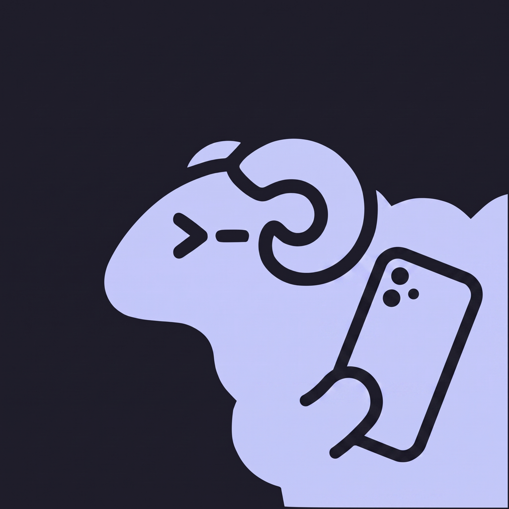
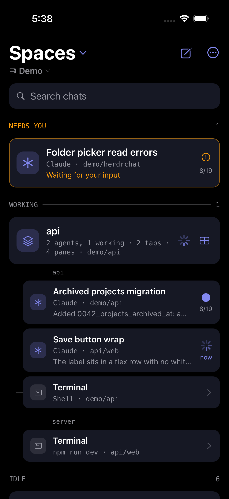
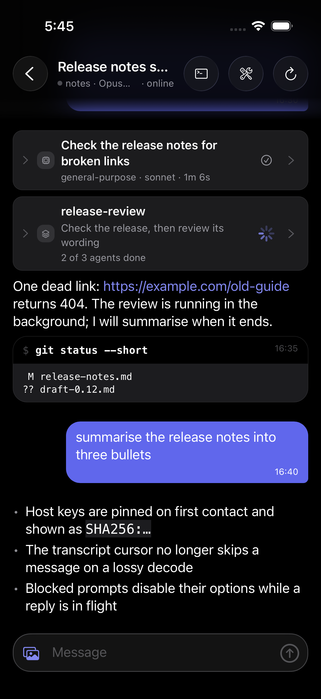
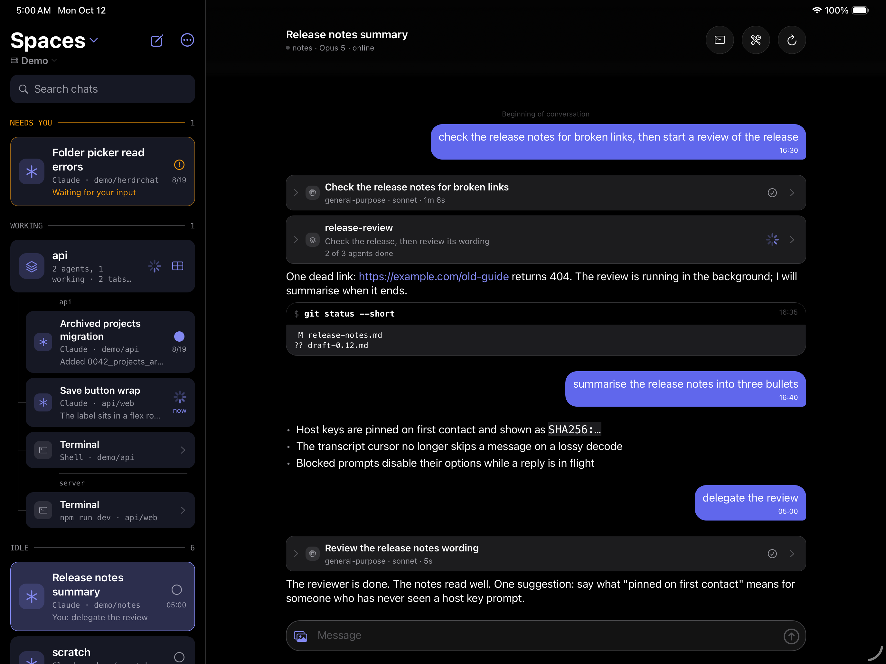
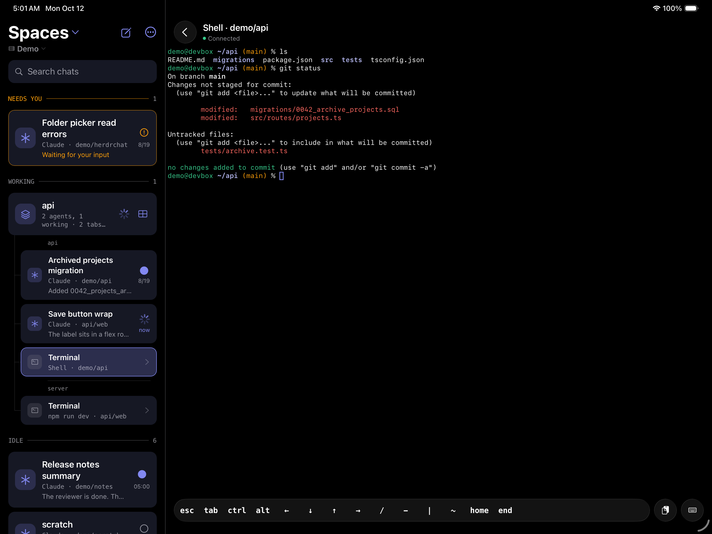
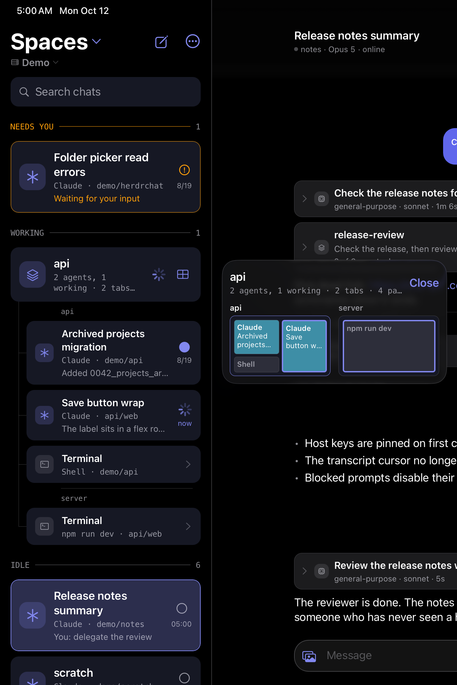
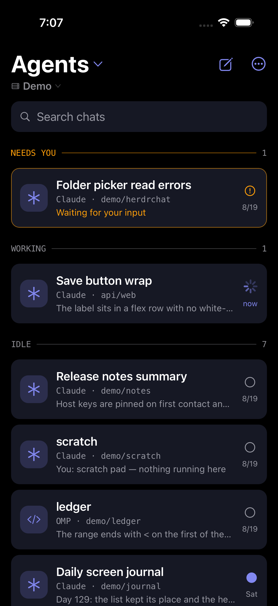
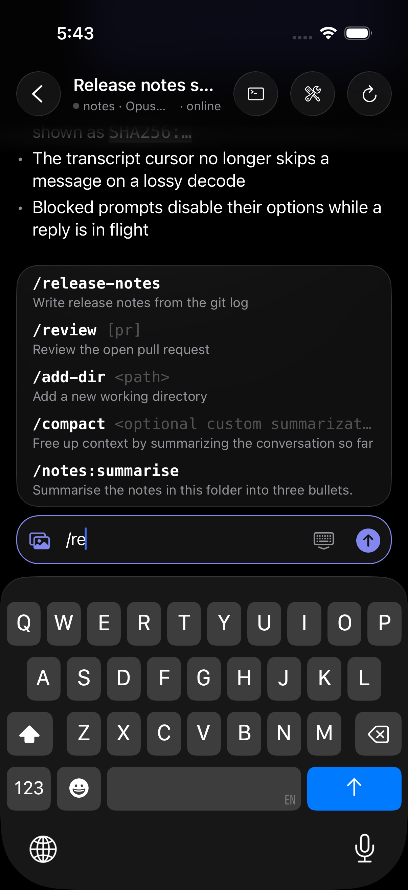

  

<h1 align="center">HerdrChat</h1>

  <strong>Claude Code, Codex, Grok, Antigravity, Pi and OMP, in your pocket.</strong> 
  Check a reply. Unblock an agent. Get back to your coffee.

  <a href="https://apps.apple.com/app/herdrchat/id6791874615"><strong>Download on the App Store</strong></a> ·
  <a href="https://herdrchat.cobanov.dev">Website</a> ·
  <a href="docs/getting-started.md">Get started</a> ·
  <a href="https://github.com/cobanov/herdrchat/issues">Issues</a>

Your agents keep running on your computer. HerdrChat turns their
[herdr](https://herdr.dev) workspaces into readable conversations on your iPhone or iPad,
connected directly over SSH. No HerdrChat account. No relay server.

  
  
   
  Demo conversations, captured in the iOS simulator on iPhone. Tap a screenshot to zoom.

  
  
   
  And on iPad, the list beside the conversation or the terminal.

## Less terminal. More conversation.

- **Pick up where you left off.** Read Claude Code, Codex, Grok, Antigravity, Pi and OMP history, including replies started at your desk.
- **See what needs you.** Search chats grouped by Needs you, Working and Idle. The title switches between **Spaces**, a card per herdr workspace that lists its agents and its terminals grouped by tab, and **Agents**, every agent a row of its own. On iPad, keep the list beside your conversation.
- **Keep things readable.** Message bubbles, code blocks, tables and compact tool activity.
- **Watch the agents it hands work to.** When Claude Code starts a subagent or a workflow, it shows in the chat as a card that says what it was asked and where it stands, then what it handed back. Open a subagent to read its own conversation as it works, or a workflow to see each phase and each agent in it.
- **Give an agent a nudge.** Send a follow-up or tap a supported approval choice.
- **Every slash command, as the terminal has them.** Type `/` for the commands the agent on that machine actually has: Claude Code's built-ins for the version installed there, your own commands and skills, the project's, and your plugins', each with what it does and what it takes. Codex chats get Codex's own menu. A command that takes nothing runs when you tap it; one that takes something fills in and shows what goes after it. The list is read from the machine in the background, every ten minutes at most, and kept on the phone.
- **Show it, don't describe it.** Add a screenshot or photo to a message; it goes to your machine over SSH and the agent opens it there.
- **Type like on a Mac.** With a hardware keyboard on an iPad or iPhone, Return sends, Shift-Return or Option-Return starts a new line, Command-Return sends either way, and Command-V attaches a copied picture. The on-screen keyboard's Return always starts a new line. Settings > Conversations > Return sends turns a hardware Return back into a new line too. On Android the same keys use Ctrl for Command and Alt for Option.
- **Keep your machine yours.** Connect over SSH, usually through Tailscale. Credentials stay in the iOS Keychain; host keys are pinned.

## Spaces

A space card says what the workspace holds (agents, how many are working,
tabs, panes) and lists it underneath. The layout button on the card draws the
workspace's tabs and panes as herdr arranges them, in a sheet on a phone; tap
a pane to open its chat or its terminal. On iPad the layout floats beside the list: a pointer resting
on the button shows it, a tap keeps it up.

  
  
  

## Try it

Just curious? Open the built-in **Demo** host. No server setup needed.

For your own agents:

1. Install HerdrChat from the [App Store](https://apps.apple.com/app/herdrchat/id6791874615) (free), or [build it locally](docs/getting-started.md#build-the-ios-app).
2. Set up herdr and the [Claude, Codex, Grok, Antigravity, Pi or OMP integration](docs/getting-started.md#prepare-your-computer) on your computer.
3. Add that computer in **Hosts** (tap the host name on Chats), test the SSH connection, and open a chat.

**On the App Store** for iPhone and iPad, iOS 17+. Android is experimental.
Push notifications need extra setup on your host. See
[setup and limitations](docs/getting-started.md).

## Several computers

Add each computer that runs herdr in **Hosts**. Chats lists the chats of every
host together: the selected host's first, then each other host's, with that
host's name at the start of the row's second line. Give a host an icon in
**Hosts** and its chats show it in place of the agent's. The phone connects to
each host itself, so every one has to be reachable over SSH from the phone, on
your tailnet for example. A host that does not answer keeps its rows and gets
one line under the chats saying why.

The selected host is the one a new chat starts on, whose theme the app wears
and whose errors fill the list.

## Terminal

  

Every herdr pane has a terminal, not only the ones running an agent you can
chat with. A pane with a shell, a build, `vim` or `htop` in it is listed under
its workspace as a **Terminal** row, with the program herdr reports and its
folder; an agent's chat opens its own pane from **Terminal** in its header,
for whatever the chat cannot show (a panel, a login prompt, a full-screen
tool). On iPad it opens beside the chats, like a conversation. It is a real emulator ([SwiftTerm](https://github.com/migueldeicaza/SwiftTerm)):
colours, cursor, mouse, selection, a swipe that scrolls back through the
pane's history (herdr's own), pinch to change the size, a
hardware keyboard with Ctrl and Option, and a bar over the software keyboard
with Esc, Tab, sticky Ctrl and Alt, the arrows, Home and End, and Paste. It
runs on the host's SSH connection: an agent pane through `herdr agent attach`,
any other pane through `herdr terminal attach` (herdr 0.9 or newer). Both draw
that one pane to the phone alone: no zoom, focus or sidebar moves on the host,
so a desktop on the same session carries on as it was. The one thing shared is
the pane's size, which follows the phone while it is attached and comes back on
leaving. A pane another phone or terminal is already attached to is refused;
**Take over** then takes it, and only when you tap it. Leaving hangs up:
nothing keeps running.
iPhone and iPad only for now.

## Theming

Each host can restyle the app with a file of its own, `~/.herdrchat/theme.json`,
so the easiest way to change how HerdrChat looks is to ask an agent on that
machine. **Settings → Appearance → Copy prompt for an agent** puts the request
on your clipboard; paste it into a chat and add what you would like ("warmer",
"green, like my terminal"). The phone picks the change up the next time the
chat list is on screen (it checks about every 10 seconds there), or at once
from **Reload theme**, and the theme follows whichever host is selected. See
[the file's shape](docs/getting-started.md#theming).

## Want to tinker?

Expo + React Native + TypeScript, with a native SSH module. The agents run on
your computer, not on the phone.

[Build & test](docs/getting-started.md#build-the-ios-app) ·
[Contributing](CONTRIBUTING.md) ·
[Conventions](CLAUDE.md) ·
[Releasing](RELEASING.md) ·
[Security](SECURITY.md)

---

[Apache-2.0](LICENSE) · [Third-party notices](NOTICE)
